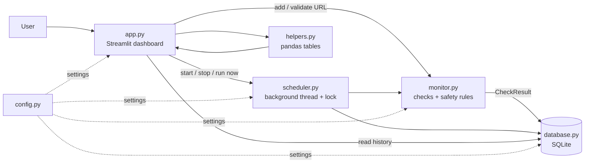

Website Health Monitor

use the app:
https://websitehealthmonitor-nzb3z4fv4k3u2n6ubgqqjg.streamlit.app/#website-health-monitor

A beginner-friendly Python tool that checks whether websites are UP, DOWN or DEGRADED, measures
response time, records HTTP status codes and error reasons, and keeps a local history you can explore
in a Streamlit dashboard.

> Only monitor websites you own or have permission to check.

<!-- Add screenshots here after running the app:


-->

Features

1. Add one or many URLs (`example.com` automatically becomes `https://example.com`)
2. Status, response time (ms), HTTP status code and last-checked time for every site
3. Clear "UP / DEGRADED / DOWN" indicators and summary metrics
4. Useful error messages: timeout, DNS failure, SSL certificate error, connection failure, HTTP 4xx/5xx
5. Tells apart "unreachable" sites from sites that "respond with an HTTP error" (a 404 is reachable)
6. SQLite history, response-time chart, per-site uptime %, list of previous failures, CSV export
7. Automatic checks at a configurable interval, with overlap protection and a minimum interval
8. Safe by design: only http/https, SSL verification always on, private/internal addresses and
  redirects to them are blocked, configurable website limit, no secrets needed
9. Automatic clean-up of history older than 30 days
10. Automated tests with mocked HTTP (no internet needed)

 How statuses work

| Status | Meaning |
|---|---|
| UP | Answered with HTTP below 400 and faster than the threshold (2000 ms) |
| DEGRADED | Reachable but not healthy: HTTP 4xx (e.g. 404), slow response, or a redirect that was not followed for safety |
| DOWN | Unreachable (timeout, DNS, SSL, connection failure), HTTP 5xx server error, or a redirect loop |

Architecture



| File | Purpose |
|---|---|
| `app.py` | Streamlit dashboard (forms, metrics, table, charts) |
| `monitor.py` | URL validation, the HTTP check, status rules, safety checks |
| `database.py` | SQLite storage: websites list and check history |
| `scheduler.py` | Background interval checks; never runs two cycles at once |
| `helpers.py` | Turns database tables into dashboard-ready pandas tables |
| `config.py` | Timeouts, limits, thresholds (some via environment variables) |
| `tests/` | Pytest suite (mocked requests, temporary databases) |
| `data/` | Where `monitor.db` is created  |

Setup (Windows, PowerShell or VS Code terminal)

```powershell
python -m venv venv
venv\Scripts\activate
pip install -r requirements.txt
```
macOS/Linux: `source venv/bin/activate` instead of the second line.

Run

```powershell
streamlit run app.py
```
A browser tab opens at `http://localhost:8501`. Add a URL in the sidebar, click "Run check now",
or press "Start monitoring" for automatic checks. Stop the app with `Ctrl+C` in the terminal.

> "Checks only run while the app is running." Automatic monitoring lives inside the Python process;
> if you close the terminal or stop Streamlit, checks stop. It is not a background service.

Test

```powershell
python -m pytest -v
```

Settings

Edit `config.py`, or set environment variables before starting the app:
`HM_REQUEST_TIMEOUT` (seconds, default 10), `HM_DEGRADED_MS` (default 2000),
`HM_MAX_WEBSITES` (default 20), `HM_RETENTION_DAYS` (default 30).

PowerShell example: `$env:HM_MAX_WEBSITES = "5"; streamlit run app.py`

Limitations

1. Runs only while the app is open; no alerts (email/Slack) yet
2. Response time is the time until the server's response headers arrive, measured from one location
3. Redirect safety checks resolve DNS before connecting, so a malicious DNS server could in theory change
  the answer in between (DNS rebinding). Do not expose this app publicly without more hardening
4. `localhost` and private-network sites cannot be monitored (deliberate security choice)
5. One check type only (HTTP GET); no content checks or authentication
6. Single user, local SQLite; not designed for hundreds of sites

Example use cases

1. A freelancer or small agency watching client websites
2. Checking a shop's storefront and checkout pages after a deployment
3. Spotting slow periods by comparing response-time charts
4. Keeping evidence of past outages (DOWN/DEGRADED history, CSV export)

Future improvements

Email/Slack alerts, deployment to a small server with a real scheduler, content/keyword checks,
SSL-expiry warnings, incident summaries written by an AI model, authentication for the dashboard.
